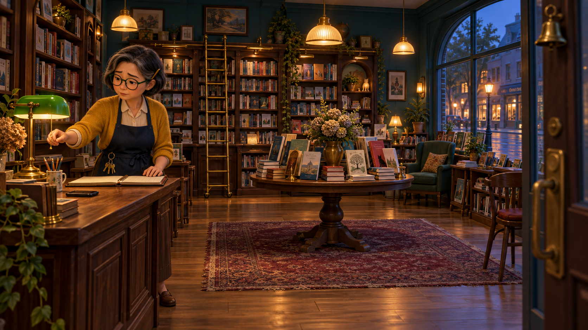
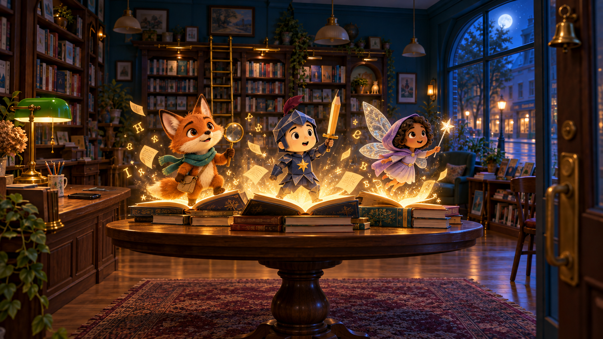
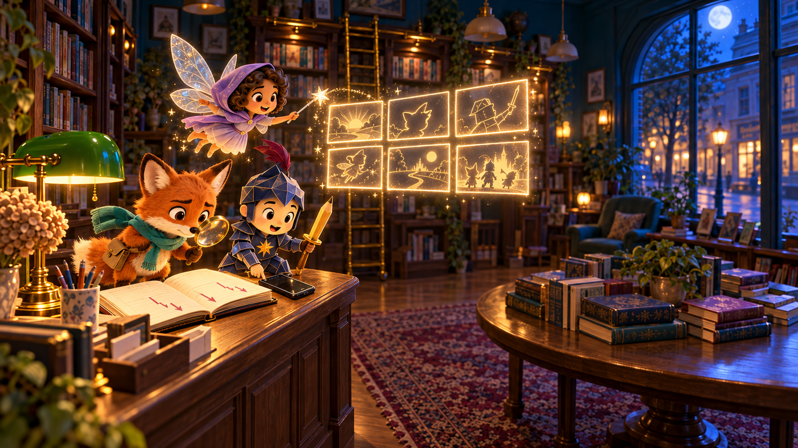
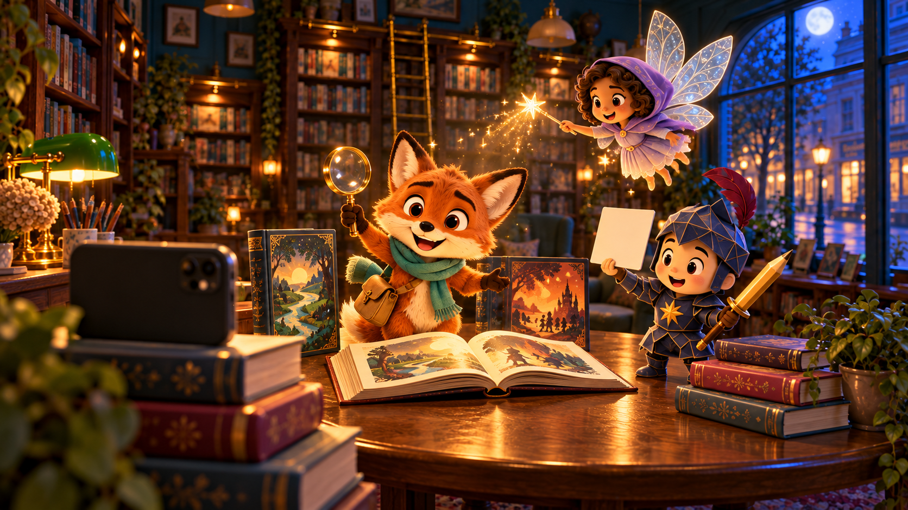
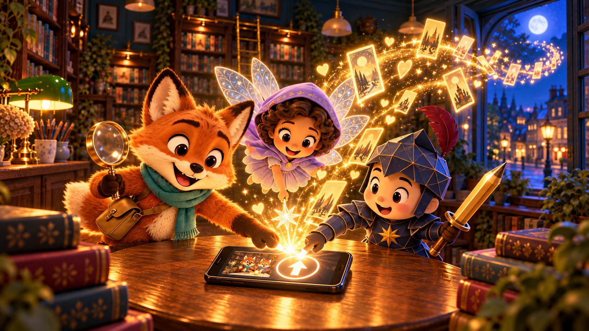
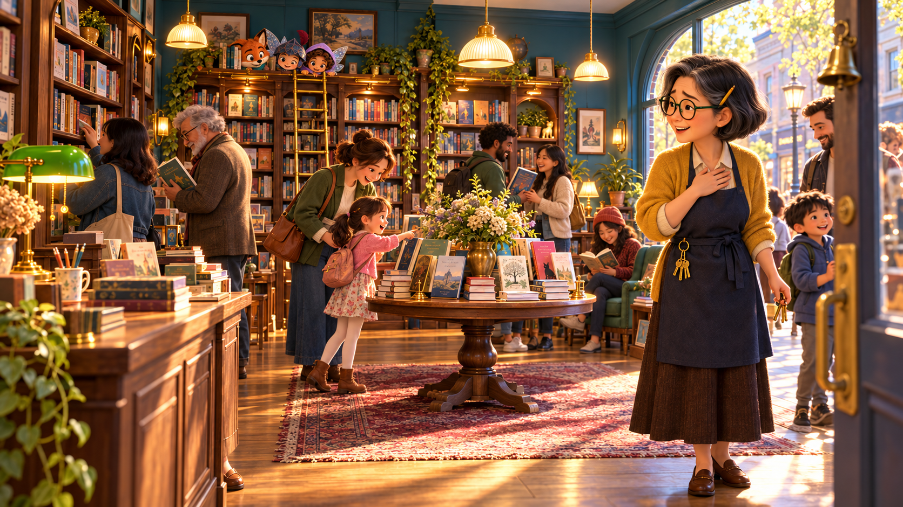

# 장면별 상세 정보

총 길이: **30초**

구성: **6개 장면**

영상 스타일: **[AI 제안] 오리지널 3D 동화 애니메이션, 16:9 시네마틱 프레임, 가족 친화적 분위기**

## 주요 등장인물과 공간

- **한미라 — AI 제안:** 한국인 여성, 50대 초반. 은빛이 섞인 짧은 단발, 둥근 짙은 초록 안경. 겨자색 카디건·크림 블라우스·남색 앞치마·짙은 갈색 발목치마·갈색 로퍼. 황동 열쇠고리와 오른쪽 귀 뒤의 나무 연필.
- **도도 — AI 제안:** 무릎 높이의 주황 여우. 크림색 주둥이, 호박색 눈, 청록 스카프, 작은 황갈색 크로스백, 황동 돋보기.
- **잉크 경 — AI 제안:** 무릎 높이의 작은 기사. 크림색 얼굴, 남색 다면 종이 갑옷, 가슴의 금빛 별, 자주색 깃털, 금빛 연필 모양 검.
- **루미 — AI 제안:** 손바닥보다 조금 큰 요정. 따뜻한 갈색 피부, 짙은 곱슬 단발, 라벤더 후드 망토·연보라 드레스, 은청색 반투명 날개, 은빛 별 지팡이.
- **서점 공간 — AI 제안:** 짙은 청록 벽, 호두나무 서가, 뒤쪽 황동 사다리, 빛바랜 버건디 러그 위 중앙 원형 테이블, 왼쪽 계산대와 초록 은행 스탠드, 오른쪽 아치형 거리 창문, 현관 위 황동 종. 밤에는 청색 달빛과 호박색 실내광, 마지막은 금빛 아침 햇살.

---

## 장면 1 — 불 꺼지는 작은 서점



- **구간:** 00:00–00:05 (5초)
- **장면 설명:** 손님이 끊긴 저녁, 미라는 텅 빈 장부를 바라보다 조용히 가게 문을 닫는다.
- **등장인물과 행동:** 한미라가 빈 매출 장부를 확인하고 초록 스탠드를 끈 뒤 황동 열쇠로 문을 잠근다.
- **주요 대사/내레이션:** 내레이션 “손님 발길이 뜸해진 어느 저녁.” / 미라 “오늘도… 여기까지인가.”
- **카메라:** 입구 안쪽의 28mm 아이레벨 와이드. 빈 의자와 중앙 테이블을 충분히 보여준 뒤 미라에게 천천히 돌리 인. 문을 닫는 동작에서 컷.
- **분위기:** 고요함, 걱정, 남아 있는 온기. 실내의 호박색과 창밖의 푸른 저녁을 대비.
- **AI 제안:** 주인 이름·나이·외형·의상·황동 열쇠·연필, 빈 매출 장부, 대사와 내레이션, 저녁 시간대 및 카메라 동선.
- **최종 이미지 프롬프트:**

```text
Create a cinematic 16:9 storyboard keyframe, polished original 3D storybook animation style, soft realistic textures, no captions, no logos, no readable text. Scene 1 opening frame in a small neighborhood bookstore at blue-hour evening. CONSISTENT SET: deep teal walls, tall walnut bookshelves packed with colorful books, a round walnut display table centered on a faded burgundy rug, a brass rolling ladder on the back wall, checkout counter on the left with a green banker lamp and an old smartphone lying face down, arched street-facing window on the right, warm amber pendant lights, a small brass bell above the front door. CHARACTER: Korean woman owner Han Mira, early 50s, short salt-and-pepper bob, round dark-green glasses, mustard cardigan over cream blouse, navy apron, dark brown ankle-length skirt, brown loafers, brass key ring at waist, wooden pencil behind right ear. She stands behind the counter looking gently worried at a nearly empty sales ledger, with the quiet empty shop surrounding her; her right hand is reaching toward the lamp switch as she prepares to close. Wide eye-level composition from just inside the entrance, 28mm lens, owner left-third, empty chairs and shelves emphasizing lack of customers. Warm interior against cool blue window light, wistful and tender, family-friendly, consistent character model and set geography for a six-scene sequence.
```

## 장면 2 — 책장이 숨 쉬는 밤



- **구간:** 00:05–00:09 (4초)
- **장면 설명:** 문이 닫히자 세 권의 책이 빛나고 도도, 잉크 경, 루미가 이야기 밖으로 깨어난다.
- **등장인물과 행동:** 도도는 돋보기와 함께 책 위로 일어서고, 잉크 경은 연필 검을 들고 주위를 살피며, 루미는 별 지팡이를 밝히며 날아오른다.
- **주요 대사/내레이션:** 책장 넘기는 소리와 작은 종소리. 도도 “어라? 미라 씨가 슬퍼 보여.”
- **카메라:** 테이블 높이의 32mm 로우 와이드. 펼쳐진 책의 빛에서 시작해 세 인물의 눈이 뜨는 순간까지 천천히 푸시 인.
- **분위기:** 신비롭지만 무섭지 않은 설렘. 달빛의 청색과 책에서 솟는 금빛의 대비.
- **AI 제안:** 세 책 속 인물의 이름·외형·소품, 세 권의 발광 책, 떠오르는 글자와 종이 입자, 효과음 및 대사.
- **최종 이미지 프롬프트:**

```text
Create Scene 2 opening keyframe for the same six-scene sequence, cinematic 16:9, polished original 3D storybook animation, soft realistic textures, family-friendly, no captions, no logos, no readable text. Preserve the referenced bookstore exactly: deep teal walls, walnut shelves, centered round walnut table on faded burgundy rug, brass rolling ladder at back, checkout counter left with green banker lamp and old black smartphone, arched window right, brass door bell. It is now after closing: no owner present, pendant lamps mostly off, front door closed, cool moonlight entering from the right window. Three ORIGINAL book characters are just awakening from three open glowing books on the round central table: (1) Dodo, a knee-high rust-orange fox with cream muzzle, large expressive amber eyes, teal scarf, tiny tan crossbody satchel, holding a brass magnifying glass; (2) Sir Ink, a knee-high childlike knight with navy folded-paper armor, cream paper face, gold star emblem on chest, tiny burgundy plume, holding a pencil-shaped sword; (3) Lumi, a hand-sized warm-brown-skinned fairy with a dark curly bob, lavender hooded cape over pale violet dress, translucent silver-blue wings, carrying a small silver star wand. Capture the exact first instant their eyes open and golden letters and paper motes rise from the books. Low wide camera from table height, 32mm lens, glowing trio foreground, dark familiar bookstore behind, mysterious but delightful blue-and-gold mood. Maintain exact character colors, costumes, props, scale, and set geography for later scenes.
```

## 장면 3 — 우리가 알리자!



- **구간:** 00:09–00:14 (5초)
- **장면 설명:** 세 친구는 장부와 스마트폰을 발견하고, 서점의 매력을 직접 영상으로 알리기로 결심한다.
- **등장인물과 행동:** 도도는 장부를 살피고, 잉크 경은 스마트폰을 발견해 감독처럼 연필 검을 세우며, 루미는 공중에 여섯 칸의 빛나는 콘티를 펼친다.
- **주요 대사/내레이션:** 루미 “직접 보여주자. 이곳이 얼마나 멋진지!” / 잉크 경 “작전명, 서점을 구하라!”
- **카메라:** 중앙 테이블에서 왼쪽 카운터를 내려다보는 35mm 사선 오버헤드. 장부→스마트폰→빛의 콘티 순으로 짧게 팬.
- **분위기:** 걱정이 아이디어로 바뀌는 순간. 영리하고 희망적이며 빠른 템포.
- **AI 제안:** 카운터의 스마트폰, 장부의 하락 표시, 루미의 6칸 마법 콘티, ‘작전명’ 대사와 역할 전환.
- **최종 이미지 프롬프트:**

```text
Create Scene 3 opening keyframe in the SAME bookstore and with the EXACT SAME three original book characters shown in the reference image, cinematic 16:9 polished 3D storybook animation, no owner present, no captions, no logos, no readable text. Preserve Dodo exactly: knee-high rust-orange fox, cream muzzle, amber eyes, teal scarf, tiny tan crossbody satchel, brass magnifying glass. Preserve Sir Ink exactly: knee-high childlike knight, cream round face, navy faceted folded-paper armor, gold star chest emblem, burgundy feather plume, golden pencil-shaped sword. Preserve Lumi exactly: hand-sized warm-brown-skinned fairy, dark curly bob, lavender hooded cape and pale violet dress, translucent silver-blue wings, silver star wand. Preserve set geography: deep teal walls, walnut shelves and back brass ladder, round table on burgundy rug center, arched moonlit window right, checkout counter left with green banker lamp. Opening moment: the trio has climbed onto the LEFT checkout counter. Dodo peers through his magnifying glass at the worried owner's open ledger with downward marks; Sir Ink discovers the old black smartphone beside it and plants his pencil sword like a confident director; Lumi hovers above and projects six small blank glowing rectangular storyboard frames in the air from her star wand. Their expressions shift from concern to a bright shared idea. Medium-wide three-quarter overhead view, 35mm lens, camera looking diagonally from the central table toward the left counter, smartphone and faces clearly visible. Blue night ambient light with warm green-lamp pool and golden magical projection, clever, hopeful, energetic. Maintain exact wardrobe, props, relative scale, and environment continuity.
```

## 장면 4 — 책 속 친구들의 촬영



- **구간:** 00:14–00:19 (5초)
- **장면 설명:** 책 더미에 세운 스마트폰 앞에서 도도가 서점을 소개하고, 잉크 경과 루미가 촬영을 돕는다.
- **등장인물과 행동:** 도도는 진행자, 잉크 경은 반사판을 든 감독, 루미는 별빛 조명을 맡는다.
- **주요 대사/내레이션:** 도도 “당신의 다음 이야기는, 바로 여기 있어요!”
- **카메라:** 스마트폰 뒤 35mm 오버더카메라 구도. 도도의 소개, 잉크 경의 큐, 루미의 조명을 리드미컬한 점프 컷으로 연결.
- **분위기:** 활기, 협업, 손수 만드는 즐거움. 따뜻한 촬영 조명과 푸른 밤의 대비.
- **AI 제안:** 책 더미 스마트폰 삼각대, 세 인물의 역할 분담, 홍보 멘트와 촬영 소품.
- **최종 이미지 프롬프트:**

```text
Create Scene 4 opening keyframe in the SAME bookstore with the EXACT SAME three original characters as the reference image, cinematic 16:9 polished 3D storybook animation, family-friendly, no owner present, no captions, no logos, no readable text. Preserve the set: deep teal walls, walnut bookshelves, back brass ladder, central round walnut table on faded burgundy rug, left checkout counter and green banker lamp, right arched moonlit window, blue night outside. Preserve Dodo exactly: rust-orange fox, cream muzzle, amber eyes, teal scarf, tan crossbody satchel, brass magnifying glass. Preserve Sir Ink exactly: cream-faced small knight in navy faceted folded-paper armor, gold star emblem, burgundy plume, golden pencil-shaped sword. Preserve Lumi exactly: small warm-brown-skinned fairy, dark curly bob, lavender hooded cape and pale violet dress, translucent silver-blue wings, silver star wand. Opening moment of their homemade promotional video shoot: an old black smartphone is propped horizontally as a camera on a stable stepped stack of books at the FRONT-LEFT edge of the central table, its back facing viewer and lens aimed across the table. Dodo stands center-stage on the table beside a beautiful open illustrated book, smiling directly toward the phone and raising his magnifying glass like a host. Sir Ink stands just off-camera on the table holding a small plain white card reflector in one hand and his pencil sword like a director's pointer in the other. Lumi hovers high right of Dodo, casting a soft warm star-shaped key light from her wand. A few colorful books are carefully fanned around Dodo as products, no text visible. Dynamic over-the-smartphone camera composition, 35mm lens, subtle diagonal leading lines, all three faces readable. Warm amber magic and cozy shelf lights against cool moonlit window; inventive, lively, teamwork energy. Maintain exact character models, wardrobe, props, scale, and set geography.
```

## 장면 5 — 마법 같은 업로드



- **구간:** 00:19–00:24 (5초)
- **장면 설명:** 세 친구가 함께 업로드를 누르자 영상이 금빛 책갈피가 되어 밤의 동네로 퍼져 나간다.
- **등장인물과 행동:** 도도·잉크 경·루미가 발, 손가락, 지팡이 끝을 한곳에 모아 업로드 아이콘을 동시에 누른다.
- **주요 대사/내레이션:** 잉크 경 “셋, 둘, 하나… 공개!” / 내레이션 “작은 영상은 밤사이 동네를 여행했다.”
- **카메라:** 40mm 미디엄 클로즈 사선 오버헤드. 스마트폰과 세 손을 중심에 놓고 금빛 흐름을 따라 창밖으로 이동.
- **분위기:** 긴장 뒤의 환희. 금빛 에너지와 짙은 밤색이 만드는 마법 같은 절정.
- **AI 제안:** 무브랜드 업로드 아이콘, 세 인물의 동시 터치, 금빛 책갈피·하트 입자의 확산, 대사와 내레이션.
- **최종 이미지 프롬프트:**

```text
Create Scene 5 opening keyframe in the SAME bookstore and with the EXACT SAME three original characters shown in the reference, cinematic 16:9 polished 3D storybook animation, family-friendly, no owner present, no captions, no logos, no readable text, no real social-media branding. Preserve Dodo exactly: rust-orange fox, cream muzzle, amber eyes, teal scarf, tan crossbody satchel, brass magnifying glass. Preserve Sir Ink exactly: cream-faced small knight in navy faceted folded-paper armor, gold star chest emblem, burgundy plume, golden pencil-shaped sword. Preserve Lumi exactly: small warm-brown-skinned fairy, dark curly bob, lavender hooded cape and pale violet dress, translucent silver-blue wings, silver star wand. Preserve the bookstore geography: deep teal walls, walnut shelves, brass ladder back, central round table on burgundy rug, checkout counter with green lamp left, arched moonlit window right. Opening moment immediately after filming: the old black smartphone lies flat at the center of the round table in landscape orientation, displaying a recognizable tiny thumbnail of Dodo presenting books and a single large simple upward-arrow upload icon, but absolutely no words or brand logos. Dodo, Sir Ink, and hovering Lumi gather tightly around it and touch the glowing icon together with one paw, one armored finger, and the tip of the star wand. At the instant of the touch, a stream of magical golden bookmark-shaped light cards and tiny heart-shaped sparks rises from the phone, arcs across the room, and begins flowing out through the right arched window toward the nighttime neighborhood. Medium close overhead three-quarter composition, 40mm lens, phone and three hands central, excited faces surrounding it, glowing stream leading toward window. Warm gold illumination on their faces against deep blue moonlight; suspenseful, triumphant, handmade creative energy. Maintain exact models, costumes, props, scale, and set continuity.
```

## 장면 6 — 다시 열린 이야기



- **구간:** 00:24–00:30 (6초)
- **장면 설명:** 다음 날 영상이 알려져 사람들이 서점으로 돌아오고, 미라는 벅찬 미소로 손님들을 맞는다.
- **등장인물과 행동:** 미라는 문가에서 손님들을 맞고, 다양한 동네 손님들이 책을 고르며, 세 친구는 뒤쪽 서가 위에서 몰래 눈짓한다.
- **주요 대사/내레이션:** 미라 “어서 오세요. 오늘은 어떤 이야기를 찾으세요?” / 내레이션 “서점의 문은 새로운 이야기로 다시 활짝 열렸다.”
- **카메라:** 첫 장면을 반향하는 28mm 아이레벨 와이드. 북적이는 중앙 테이블에서 미라로 이동한 뒤 뒤쪽 서가의 세 친구로 랙 포커스.
- **분위기:** 밝고 따뜻한 안도감과 공동체의 기쁨. 아침 햇살로 첫 장면과 대비.
- **AI 제안:** 다음 날 아침, 다양한 연령의 손님 구성, 미라의 환영 대사, 세 친구의 비밀스러운 눈짓과 마지막 랙 포커스.
- **최종 이미지 프롬프트:**

```text
Create Scene 6 final opening keyframe, the next morning in the EXACT SAME bookstore and the conclusion of the six-scene sequence, cinematic 16:9 polished original 3D storybook animation, family-friendly, no captions, no logos, no readable text. Use the first reference for the exact owner and bookstore, and the second reference for the exact book characters. OWNER Han Mira must match exactly: Korean woman early 50s, short salt-and-pepper bob, round dark-green glasses, mustard cardigan over cream blouse, navy apron, dark brown ankle-length skirt, brown loafers, brass key ring at waist, wooden pencil behind right ear. BOOK CHARACTERS must match exactly: Dodo rust-orange fox with cream muzzle, teal scarf, tan satchel and brass magnifying glass; Sir Ink cream-faced small knight in navy faceted paper armor with gold star, burgundy plume and golden pencil sword; Lumi small warm-brown-skinned fairy with dark curly bob, lavender hooded cape and pale violet dress, translucent silver-blue wings and silver star wand. Preserve set: deep teal walls, walnut shelves, brass ladder back, central round table on faded burgundy rug, left counter with green lamp, right arched street window, brass bell above front door. Bright golden morning. The front door at near-right is open and a cheerful mixed-age group of neighborhood customers enters and browses; a child and parent approach the central display, an older man selects a book, two young adults chat by the window, making the shop lively but not overcrowded. Han Mira stands just inside the doorway holding her brass keys, surprised and deeply relieved, one hand over her heart as she smiles. High on the BACK walnut shelf, partially hidden behind three books, tiny Dodo, Sir Ink, and Lumi peek out together and exchange a secret proud wink; they remain clearly recognizable but are not noticed by customers. Wide eye-level composition echoing Scene 1, 28mm lens, owner on right third, busy central table and customers, hidden characters visible in back upper-left shelf. Sunbeams, warm amber lights, hopeful celebratory atmosphere, visual contrast to the empty first scene. Maintain exact character models, wardrobe, props, scale, and set geography.
```
